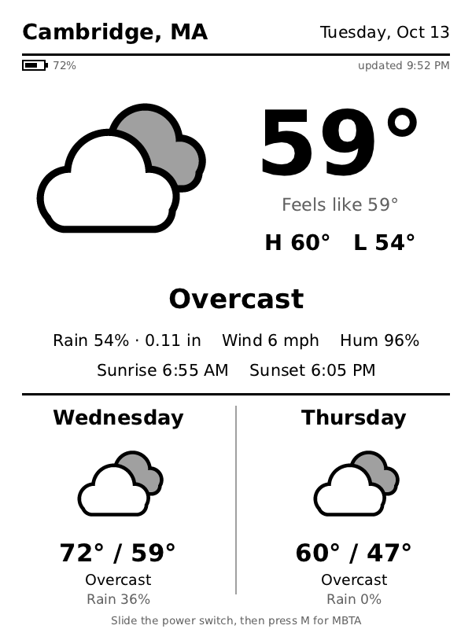
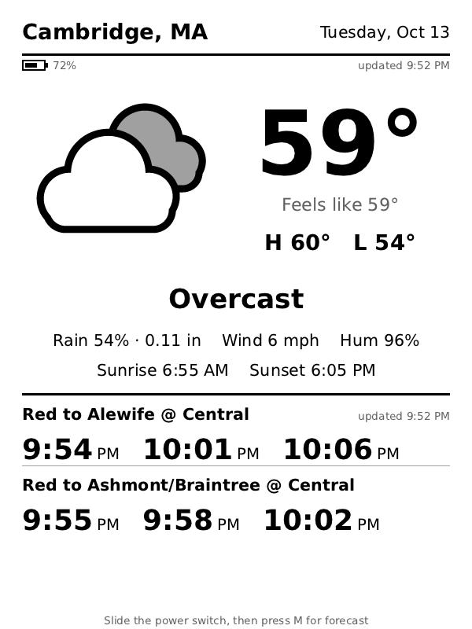

# k3-weather

A full-screen weather and transit display for a jailbroken Kindle 3 (Keyboard), written in Zig.

<p align="center">
  
  
</p>

- **Today:** current temperature, feels-like, high/low, conditions, rain chance and amount, wind, humidity, sunrise and sunset.
- **Bottom half, switchable with the M key:**
  - the next two days (icon, high/low, conditions, rain chance), or
  - live MBTA departures: the next 3 for up to 3 stops.
- **Blended forecast:** one request fetches three forecast models (NOAA GFS/HRRR, ECMWF and DWD ICON) from [Open-Meteo](https://open-meteo.com), and the app combines them.
  - Numbers are the average of the models that returned data.
  - Weather conditions go to a plurality vote; on a three-way tie, GFS wins.
  - Open-Meteo has no server-side cross-model average; its default `best_match` picks a single model per location.
- **Refreshes** every 30 minutes, or every 5 minutes while the MBTA view is showing. Each refresh is a full e-ink refresh, which clears ghosting.
- **Battery:** a battery indicator under the header turns bold with "charge me" at 20% or below. `battery.csv` logs the level at every refresh.
- **Power saving:** by default the Kindle is suspended between refreshes and woken by its RTC alarm, and wifi is only on while fetching.
- **No API keys.** Open-Meteo is fetched over plain HTTP, so the Kindle's outdated TLS stack doesn't matter. MBTA is fetched over HTTPS with Zig's own TLS client.
- **A single static ARM binary** (musl, soft-float, ARM1136). The Kindle needs nothing beyond a jailbreak and KUAL.

## Build

Requires Zig 0.17. With Nix, `nix develop` gives you a shell with it, pinned in `flake.nix` and `flake.lock`.

```sh
zig build --release=small   # Kindle build: a ready-to-copy KUAL extension in zig-out/extensions/weather/
zig build test              # unit tests
```

Preview on your desktop, with no Kindle needed:

```sh
zig build preview -- --png out.png --lat 40.71 --lon -74.01 --name "New York" --units imperial
```

Add `--battery 72` to fake a battery level, `--json FILE` to render a saved Open-Meteo response, and `--view mbta --mbta "STOP ROUTE DIR LABEL"` to preview the MBTA view. `--help` lists every option.

## Install

1. Install [KUAL](https://www.mobileread.com/forums/showthread.php?t=203326) on the Kindle. It needs the jailbreak and the developer-key Kindlet patch.
2. Plug the Kindle in over USB, and copy `zig-out/extensions/weather` to `extensions/weather` on the Kindle drive.
3. Edit `extensions/weather/weather.conf` on the Kindle (see [Configuration](#configuration)).
4. Eject, open KUAL, and choose **Weather → Start weather display**.

**To update an existing install,** copy only `zig-out/extensions/weather/bin/`. Copying the whole folder replaces your `weather.conf`.

Without KUAL, over SSH or usbnet, run:

```sh
sh /mnt/us/extensions/weather/bin/weather.sh start   # or: stop
```

## Using it

| Key | Action |
| --- | --- |
| Home or Back | exit and return to the normal Kindle UI. Press a key once more if the old screen doesn't repaint. |
| M | switch the bottom half between the next two days and MBTA departures (only when MBTA rows are configured) |
| Any other key | refresh now |

In sleep mode (the default), keys only work while the Kindle is awake. Slide the power switch to wake it. The status line then says "Awake: …", and you have a minute to press a key before it sleeps again.

While the display runs, the launcher:

- stops the screensaver from triggering (`preventScreenSaver`), so powerd never suspends the Kindle on its own
- pauses the stock UI process (`killall -STOP cvm`), so it doesn't draw over the display

Both are undone when the app exits, and wifi is switched back on.

If a fetch fails, the last good data stays on screen, with `OFFLINE (reason)` in the status line. If no data has loaded yet, the app retries every minute.

## Configuration

Everything lives in `extensions/weather/weather.conf`:

| Setting | Default | Meaning |
| --- | --- | --- |
| `LAT`, `LON`, `NAME` | Cambridge, MA | location, and the label shown in the header |
| `UNITS` | `imperial` | `metric` or `imperial` |
| `INTERVAL` | `1800` | seconds between refreshes in the forecast view |
| `WIFI_SAVER` | `1` | switch wifi on only while fetching |
| `SLEEP` | `1` | suspend the Kindle between refreshes; `0` keeps it awake (see [Sleep mode](#sleep-mode)) |
| `MBTA1`…`MBTA3` | two Red Line rows | MBTA rows; see [MBTA departures](#mbta-departures) |
| `MBTA_INTERVAL` | `300` | seconds between refreshes in the MBTA view |
| `VIEW` | `mbta` | bottom half at start: `mbta` or `days` |
| `EXTRA_ARGS` | | extra command-line options, e.g. `--no-invert` |

With `WIFI_SAVER=1`, the app turns wifi on before each fetch with `lipc-set-prop com.lab126.wifid enable 1`. It retries for up to 60 seconds while the network comes up, which usually takes 8–15 s, then switches wifi off again.

## Sleep mode

By default (`SLEEP=1`), the app suspends the Kindle between refreshes and wakes it with the RTC alarm, the way [kindle-dash](https://github.com/pascalw/kindle-dash) does on the Kindle 4:

1. It writes the number of seconds until the next refresh to `/sys/devices/platform/mxc_rtc.0/wakeup_enable`, which belongs to Amazon's RTC driver.
2. It writes `mem` to `/sys/power/state`. That write returns when the RTC alarm, or the power switch, wakes the Kindle.

The next refresh is due one period after the previous one *started*, so the 20–25 s spent waking, reconnecting and fetching doesn't add to every cycle. In testing, the RTC woke the Kindle within 1–2 s of the requested time.

The forecast stays on screen while the Kindle is suspended, because e-ink keeps its image without power. powerd stays out of it: the stock UI remains paused and `preventScreenSaver` remains 1, so the Kindle never shows its own screensaver. After every wake, the log records the kernel's wake source. If the kernel refuses to suspend, the log says why, and the app stays awake for that cycle.

For comparison, staying awake with the wifi saver on and 5-minute MBTA refreshes drained about 4.6% of the battery per hour, roughly 20 hours per charge. The battery log shows how much sleep mode improves on that.

**Why not powerd?** The usual Kindle approach is to set powerd's `rtcWakeup` property during its brief `readyToSuspend` state. On the Kindle 3, that didn't work:

- With the stock UI paused, powerd accepted the request but never programmed the alarm.
- With the stock UI resumed for the sleep, powerd never became ready at all.

The KUAL menu's **Sleep/wake test** (`bin/sleeptest.sh`) is the diagnostic used for those experiments. It isn't needed for normal use.

## MBTA departures

Each row in `weather.conf` is `STOP ROUTE DIRECTION LABEL`:

```sh
MBTA1="place-cntsq Red 1 Red to Alewife @ Central"
MBTA2="place-cntsq Red 0 Red to Ashmont/Braintree @ Central"
```

- **Stop IDs** come from `https://api-v3.mbta.com/stops?filter[route]=<route>`. Subway stations use their `place-…` ID.
- **Direction** is `0` or `1`. On the Red Line, `0` is Ashmont/Braintree and `1` is Alewife. On buses, `0` is outbound and `1` is inbound.
- **To turn the MBTA view off,** remove all the rows. The M key and its hint then disappear.

Departures are shown as clock times, which stay correct even when the screen is a few minutes old. "updated …" at the top right of the section says when they were fetched.

Some technical details:

- **HTTPS.** MBTA's API is HTTPS-only. The app runs Zig's TLS client (`std.crypto.tls`) on its own libc socket code. It verifies certificates against Amazon's root certificates plus the Starfield root that cross-signs them, all embedded in `assets/mbta-roots.pem`; the Kindle's own certificate store is years out of date. If MBTA changes certificate authority, update that file.
- **No API key.** Without a key, MBTA allows 20 requests a minute. The app makes one per row per refresh, plus a one-time stop lookup per row.
- **Unknown stop IDs.** The predictions endpoint silently ignores an unknown stop and returns departures from other stops on the route. So the app looks up each stop once, and a typo shows up as `Unavailable (UnknownStop)` instead of wrong times.

## Troubleshooting

The log is `extensions/weather/weather.log`.

- **What's in it:** every line has a timestamp, and each start adds a `=== … start (SLEEP=… …)` marker. The log carries on across runs, and moves to `weather.log.old` once it passes 200 KB. Fetches (with wifi connection times), MBTA requests, key presses (with key codes) and sleep/wake events are all logged.
- **The screen looks like a photo negative:** set `EXTRA_ARGS="--no-invert"`. The Kindle 3's 4-bit framebuffer stores white as 0, and the app assumes that by default.
- **The image is drawn but the screen never changes:** the app tries the `FBIO_EINK_UPDATE_DISPLAY` ioctl first, then `/proc/eink_fb/update_display`. Check the log for errors.
- **Home doesn't exit:** look up the key code in the log, and add it to the `.quit` case in `Inputs.wait` in `src/main.zig`.
- **`No data yet (Resolve)` or `OFFLINE (Resolve)`:** wifi isn't connected. Connect once from the normal Kindle UI before starting.

## Development

```
src/main.zig     config/args, key input, the App: update + the awake/asleep run loops
src/forecast.zig weather model, Open-Meteo fetch, multi-model blend
src/mbta.zig     MBTA rows, predictions fetch/parse, the Board shown on screen
src/ui.zig       screen layout: renders a plain Screen value, no I/O
src/kindle.zig   Kindle integration: battery, wifi, RTC suspend/wake, battery CSV
src/sys.zig      libc helpers: logging, clocks, files, shell commands
src/canvas.zig   600x800 grayscale canvas, anti-aliased shapes, TrueType text
src/icons.zig    procedural weather icons + WMO code descriptions
src/net.zig      minimal HTTP/1.0 client on libc sockets, plain and TLS (std.crypto.tls)
src/display.zig  einkfb framebuffer output (4/8 bpp) and a PNG writer for previews
src/ttf.c        shim over vendor/stb_truetype.h
assets/          DejaVu Sans fonts and MBTA root certificates (embedded in the binary)
kindle/          KUAL extension: menu, launcher script, config
```

The Kindle 3 runs Linux 2.6.26, which shapes a few choices:

- **No `std.net`.** The kernel rejects `SOCK_CLOEXEC` in `socket()`. musl's libc wrappers retry without it, but Zig's raw-syscall networking doesn't.
- **Busybox 1.7.2.** The shell scripts avoid newer shell and busybox features such as `grep -E`, `head -1` and `command -v`.
- **Checking a new Zig release:** run the ARM binary under `qemu-arm -cpu arm1136 -strace`, and make sure it doesn't use system calls newer than that kernel.

The screenshots in `docs/` come from `zig build preview` with `--png docs/forecast.png --view days` and `--png docs/mbta.png --view mbta`, plus `--units imperial --battery 72 --sleep` and the two `--mbta` rows from `weather.conf`.

## License

The code is MIT-licensed; see [`LICENSE`](LICENSE). The bundled fonts, `stb_truetype.h` and root certificates keep their own terms, listed below.

## Credits and third-party notices

- **Weather data:** [Weather data by Open-Meteo.com](https://open-meteo.com/), licensed under [CC BY 4.0](https://creativecommons.org/licenses/by/4.0/). The app uses the free API, which is for non-commercial use; see [Open-Meteo's terms](https://open-meteo.com/en/terms). The forecast shown is a blend of the NOAA GFS/HRRR, ECMWF IFS and DWD ICON models, all served by Open-Meteo.
- **Transit data:** departure predictions come from the [MBTA V3 API](https://www.mbta.com/developers/v3-api), used under the [MassDOT Developers License Agreement](https://www.mass.gov/files/documents/2017/10/27/develop_license_agree_0.pdf). This project is not affiliated with, endorsed by, or supported by the MBTA or MassDOT.
- **Fonts:** DejaVu Sans and DejaVu Sans Bold (`assets/DejaVuSans*.ttf`) are embedded in the binary. They are derived from Bitstream Vera, © Bitstream, Inc.; DejaVu's own changes are public domain. Their full license is in [`assets/DejaVu-LICENSE`](assets/DejaVu-LICENSE).
- **Font rendering:** [`stb_truetype.h`](vendor/stb_truetype.h) by Sean Barrett, under MIT or public domain at your choice. Its license text is at the end of the file.
- **Root certificates:** `assets/mbta-roots.pem` contains Amazon's and Starfield's publicly distributed root CA certificates, taken from the standard CA bundle.

Kindle is a trademark of Amazon.com, Inc. This project is not affiliated with Amazon.
